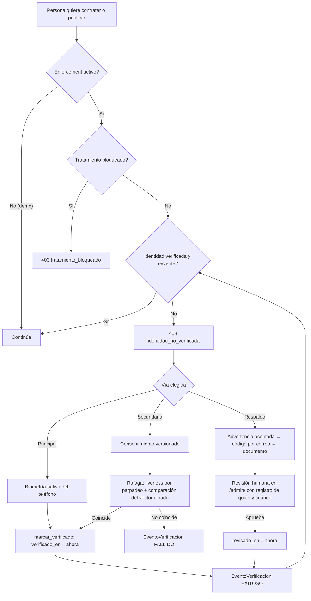

# ADR 0001 — Estrategia de verificación de identidad

- **Estado:** aceptada (2026-10-11), implementada en Fases 2–3.
- **Contexto:** KeyServ debe verificar la identidad al **contratar** y al **publicar** (regla de negocio) tratando la
  biometría como dato sensible (Ley 21.719): minimizar, pedir consentimiento y no depender de un solo mecanismo. Ya existía
  reconocimiento facial en servidor con prueba de vida por parpadeo y un desbloqueo biométrico nativo en la app.

## Opciones evaluadas

| Opción | Qué es | Evaluación |
|---|---|---|
| A. Biometría del dispositivo (nativa) | Face ID / huella del teléfono vía plugin de Capacitor; el servidor solo recibe "aprobado" | **Elegida como vía principal**: el servidor nunca ve el dato (máxima minimización). Limitación: prueba "es quien desbloquea este teléfono", no la identidad legal |
| A'. WebAuthn / passkeys | Firma criptográfica por dispositivo, también para web | **No adoptada por ahora**: aporta lo mismo que A para el navegador, pero exige registrar credenciales por dispositivo y un backend WebAuthn nuevo; el demo no tiene usuarios web que lo necesiten. Reevaluar al abrir producción web |
| B. Rostro en servidor | Ráfaga → vector de 128 números cifrado → comparación | **Conservada como vía secundaria** (quien no tiene sensor nativo). Requiere consentimiento explícito; solo se guarda el vector, nunca la imagen; liveness por parpadeo |
| C. Sin biometría (MFA) | Advertencia aceptada + código por correo + documento revisado por una persona | **Implementada** como respaldo, más lenta a propósito. TOTP y firma electrónica avanzada/ClaveÚnica: **investigados, no implementados** |

## Decisión

1. **Principal:** biometría nativa. **Secundaria:** rostro en servidor con consentimiento versionado y revocable.
   **Respaldo:** vía sin biometría con revisión humana (superusuario o Moderador; queda quién y cuándo).
2. Las tres convergen en `identidad.identidad_verificada()`, que además exige que la verificación sea **reciente**
   (ver ADR 0003). El enforcement se enciende con `EXIGIR_IDENTIDAD_VERIFICADA` (apagado en el demo).
3. Cada intento deja un `EventoVerificacion` sin datos biométricos.

## Flujo (Mermaid)

## Consecuencias

- La vía nativa no deja nada biométrico en el servidor; la secundaria deja un vector cifrado; la de respaldo deja un
  documento de identidad en almacenamiento privado.
- Una verificación vencida (180 días) obliga a repetirla, también en la vía de respaldo.
- **Plan de migración de datos:** los vectores existentes se cifraron en la migración `0031`; no había imágenes en bruto
  que migrar ni borrar (ver `docs/fase-1-auditoria-datos.md` §1). La migración `0033` fijó `verificado_en` = fecha de la
  migración para quienes ya estaban verificados.
